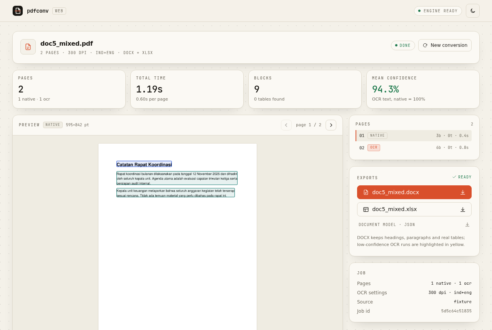
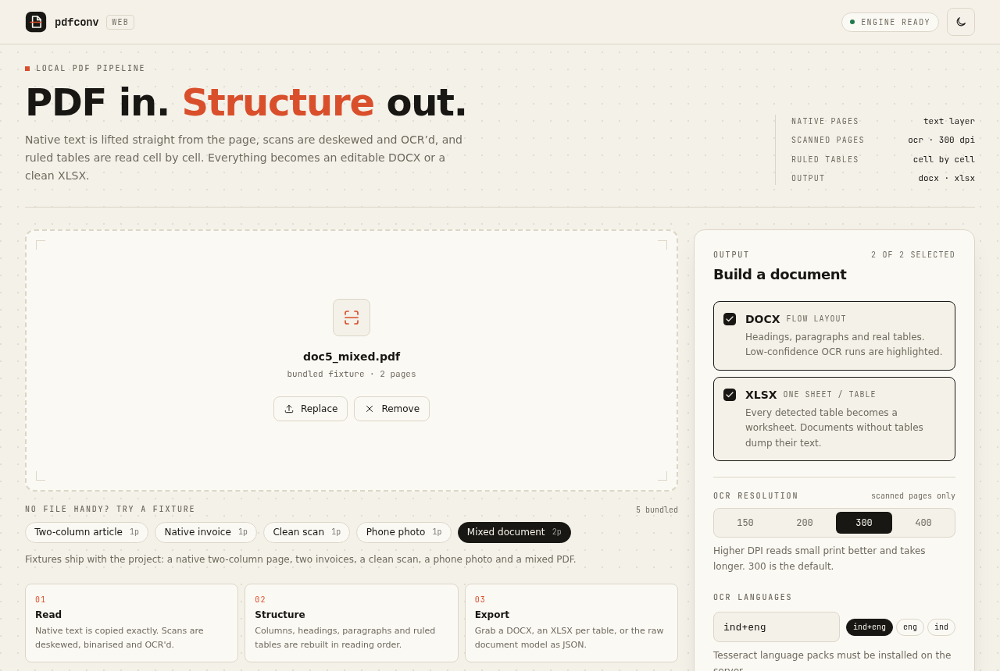

# PDF Converter — POC

Converts a native or scanned PDF into editable DOCX, XLSX and a JSON document
model. Every extractor writes to a single intermediate model
(`pdfconv/model.py`); exporters only read from that model, so the CLI and the
web app share exactly one pipeline.



## Highlights

- **Per-page routing.** A page with an embedded text layer is extracted
  directly (fast, exact). Scanned pages are rendered at the chosen DPI,
  deskewed, binarised and OCR'd with Tesseract — an existing text layer on a
  scan is ignored, because it is usually poorer than a fresh OCR pass.
- **Ruled tables.** Grid lines are found with OpenCV morphology; cells are
  OCR'd in parallel with PSM 7 and rebuilt as real tables.
- **DOCX with structure.** Editable flow layout — headings, paragraphs and
  tables — with low-confidence OCR runs highlighted in yellow. A scanned page
  can instead be kept as a page-sized image so the output looks like the
  source; `auto` mixes both behaviours per page.
- **XLSX with one sheet per table.** Documents without tables dump their text
  into a single sheet.
- **JSON model.** Page size, source, blocks, bounding boxes and confidence for
  every page — useful for debugging or downstream processing.
- **Web UI.** Drag/drop or pick a bundled fixture, watch per-page progress,
  inspect the rendered page with colour-coded block overlays, filter
  low-confidence OCR, and download the results. Jobs can be discarded while
  running; finished jobs expire after an hour.

## Quick start (NixOS, CLI)

```bash
nix-shell -p python312 python312Packages.pip tesseract
python3 -m venv .venv
./py -m pip install -r requirements.txt
./py -c "import pymupdf, docx, openpyxl, cv2; print('ok')"
./py -m pdfconv.cli input.pdf --out out --json out/model.json
```

`./py` is a tiny wrapper that puts the NixOS `libstdc++` and `zlib` on
`LD_LIBRARY_PATH` so the wheel-based dependencies load.

## Web UI

Drop in a PDF or pick one of the bundled fixtures, then choose outputs and OCR
settings:



### Docker (recommended)

```bash
docker compose up --build
# http://localhost:8000
```

The image builds the React app, installs Tesseract with `eng` + `ind` data,
and runs as an unprivileged user with a healthcheck. Job data lives in the
`pdfconv-jobs` volume and expires after an hour. The NixOS `LD_LIBRARY_PATH`
wrapper is not needed inside the container.

### Local development

```bash
./py -m pip install -r requirements.txt
cd web && npm install && cd ..

# terminal 1: API on :8000
./py -m api

# terminal 2: Vite on :5173, proxying /api to :8000
cd web && npm run dev
```

For a single-process production build:

```bash
cd web && npm run build && cd ..
./py -m api            # serves web/dist at http://127.0.0.1:8000
```

If `web/dist` is missing, `/` shows a short build hint instead; the API and
`/docs` still work.

### How it fits together

```
web/ (React SPA)
   │ POST /api/jobs, then poll status
   ▼
api/main.py ──▶ api/jobs.py ──▶ pdfconv.pipeline.convert
   │                                   │  (native extract | OCR)
   │                                   ▼
   └── serves web/dist            DOCX · XLSX · model.json
```

- `api/main.py` — routes, validation, previews, overlays, downloads, static
  SPA mount.
- `api/jobs.py` — in-memory registry, thread pool, cooperative cancellation,
  TTL sweeping (including directories orphaned by a previous process).
- `pdfconv/pipeline.py` — the conversion loop, with an optional `on_page`
  callback used by the web layer to report progress. The CLI path is
  unchanged.

Conversions are CPU-heavy, so the API accepts a job immediately and the
frontend polls for page-by-page progress. Job state is in memory: run a single
uvicorn worker (the Docker image does).

### API

| Method | Path | Purpose |
|--------|------|---------|
| `POST` | `/api/jobs` | multipart `file` (or `fixture`) + `formats`, `dpi`, `lang`, `layout` |
| `GET` | `/api/jobs/{id}` | status, per-page progress, timings, confidence |
| `GET` | `/api/jobs/{id}/pages/{n}/preview.png` | rendered page (`?dpi=40..200`) |
| `GET` | `/api/jobs/{id}/pages/{n}/blocks` | blocks + bboxes for the overlay |
| `GET` | `/api/jobs/{id}/download/{docx,xlsx,json}` | finished artifacts |
| `GET` | `/api/fixtures` | bundled sample PDFs |
| `DELETE` | `/api/jobs/{id}` | discard a job and its files |
| `GET` | `/api/health` | engine/tesseract status |

`POST /api/jobs` fields: `file` **or** `fixture`, `formats` (comma-separated
`docx,xlsx`), `dpi` (72–600, default 300), `lang` (Tesseract language list,
default `ind+eng`), `layout` (`auto`, `flow`, `facsimile`; default `auto`).
`auto` rebuilds pages that have real text and keeps scanned pages as images;
`flow` always rebuilds every page as editable text; `facsimile` inserts every
page as a page image. JSON is always available from the job's model.
Interactive API docs are at `/docs`.

Configuration:

| Variable | Default | Meaning |
|----------|---------|---------|
| `PDFCONV_JOB_DIR` | `<tmp>/pdfconv-jobs` | upload/output root |
| `MAX_UPLOAD_MB` | `50` | upload size limit |
| `MAX_PAGES` | `100` | page-count limit per job |
| `JOB_TTL_MIN` | `60` | minutes before finished jobs are deleted |
| `MAX_WORKERS` | `2` | concurrent conversions |
| `MAX_ACTIVE_JOBS` | `4` | queued + running jobs accepted |
| `CORS_ORIGINS` | `localhost:5173`, `127.0.0.1:5173` | comma-separated dev origins |
| `HOST` / `PORT` | `127.0.0.1` / `8000` | bind address for `./py -m api` |
| `RELOAD` | off | auto-reload for local development |

### Tests

```bash
./py -m pip install -r requirements-dev.txt
./py -m pytest
```

The API tests run the real pipeline over the bundled fixtures (native and OCR
paths) and check downloads, previews, overlays, upload validation, filename
sanitising and cancellation. `tests/conftest.py` points `PDFCONV_JOB_DIR` at a
throwaway directory so test runs never touch the dev job store.

## Project layout

```
pdfconv/   extractors, OCR, pipeline, exporters, CLI
api/       FastAPI app and background job manager
web/       React 19 + Vite 7 + Tailwind 4 single-page app
fixtures/  sample PDFs used by the UI, tests and eval
tests/     API tests over real conversions
docs/      screenshots used by this README
```

## Dependencies

```
pymupdf python-docx openpyxl opencv-python-headless numpy reportlab
fastapi uvicorn[standard] python-multipart
```

Test extras: `pytest`, `httpx`. Frontend: `cd web && npm install`.

OCR uses the system `tesseract` binary (language data for `ind` and `eng` are
required). On NixOS, `nix-shell -p tesseract` provides both.

## Usage (CLI)

```
pdfconv in.pdf --to docx,xlsx --out out/ [--dpi 300] [--lang ind+eng] [--layout auto|flow|facsimile] [--json model.json]
```

- Native pages are copied exactly; scanned pages go through deskew, binarise
  and OCR.
- Ruled tables are detected via OpenCV line morphology and OCR'd cell by cell
  (parallel, per-cell PSM 7).
- DOCX layout is chosen with `--layout`: `auto` (default) rebuilds text pages
  and keeps scanned pages as images, `flow` rebuilds every page as editable
  text, `facsimile` turns every page into a full-page image. Low-confidence
  OCR runs are highlighted in yellow in the text modes.
- XLSX gets one sheet per detected table; if no table is found, text is
  dumped to a single sheet.
- `--json` writes the intermediate document model for inspection.

## Quality (5 synthetic fixtures, `./py eval.py`)

| Document               | CER    | WER    | s/page | Table cells |
|------------------------|-------:|-------:|-------:|------------:|
| doc1 native 2-col      | 0.00%  | 0.00%  | 0.44   | n/a         |
| doc2 native invoice    | 0.00%  | 0.00%  | 0.21   | 25/25       |
| doc3 clean scan (OCR)  | 0.00%  | 0.00%  | 1.04   | n/a         |
| doc4 phone photo (OCR) | 0.00%  | 0.00%  | 2.38   | 25/25       |
| doc5 mixed PDF         | 0.00%  | 0.00%  | 0.44   | n/a         |

## Known limits

- Flow layout is approximate: multi-column pages are linearised and exact
  text positions are not reproduced. Use `auto` or `facsimile` when a page
  must look like the source.
- Tables must be ruled (visible grid lines) on scanned pages; borderless
  tables fall back to text.
- Merged cells are not modelled.
- PPTX is out of scope for this POC.
- Only single-line cell text is recognised (PSM 7).
- Handwriting and complex nested layouts are not handled.
- Docling (IBM) was evaluated as a drop-in alternative (Step 0 gate):
  Docling CER ≈ 26% on doc3/doc4 vs 0% for this pipeline, and ~3.5× slower
  on doc3. The custom pipeline is retained.
